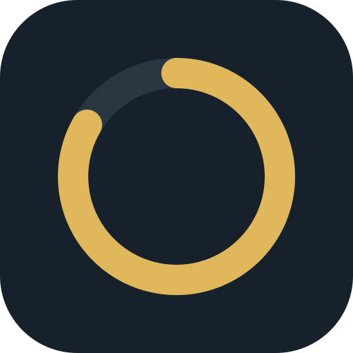

# Clean Streak

**➜ [App öffnen und installieren](https://robinrhl.github.io/clean-streak/)**

Ein schlanker, werbefreier Abstinenz-Tracker. Kein Abo, kein Konto, kein Server.

## Funktionen
- Live-Zähler seit dem Start (Tage, Stunden, Minuten)
- Meilensteine (1, 3, 7, 14, 30, 60, 90, 180, 365, 730 Tage)
- Täglicher Check-in
- Rückfall eintragen mit optionalem Auslöser, Rekord bleibt erhalten
- Mehrere Gewohnheiten parallel
- Backup und Wiederherstellung per Text

## Installation als App
Seite im Browser öffnen, dann „Zum Home-Bildschirm“ (iPhone: Teilen-Menü in Safari, Android: Menü in Chrome). Die App startet danach im Vollbild und funktioniert auch offline.

**Android:** am besten mit Chrome installieren. Firefox übernimmt das App-Icon nicht zuverlässig.

## Datenschutz
Alle Daten bleiben im `localStorage` deines Browsers. Nichts wird übertragen.
Mach regelmäßig ein Backup, denn gelöschte Browserdaten löschen auch den Verlauf.

## Nutzung
Über GitHub Pages aufrufen und auf dem Handy über „Zum Home-Bildschirm“ wie eine App installieren.
Alternativ `index.html` einfach lokal im Browser öffnen.

## Lizenz
MIT
